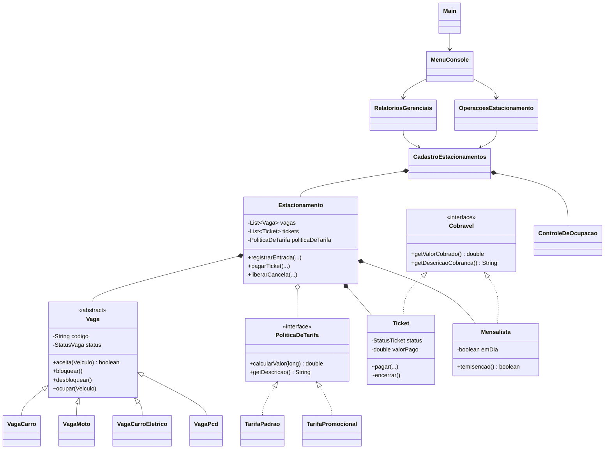

# Diagrama de classes — Estacionamento Inteligente

A imagem principal e legível em zoom está em **`docs/diagrama-classes.png`**. O arquivo `diagrama-classes.svg` permite ampliação sem perda e `diagrama-classes.dot` contém o diagrama completo em Graphviz, com atributos, métodos e relacionamentos.

### Visão resumida da estrutura

A imagem `.png` e a versão `.dot` apresentam também `Veiculo`, `Placa` (record), os enums e os vínculos de associação, realização e composição.
